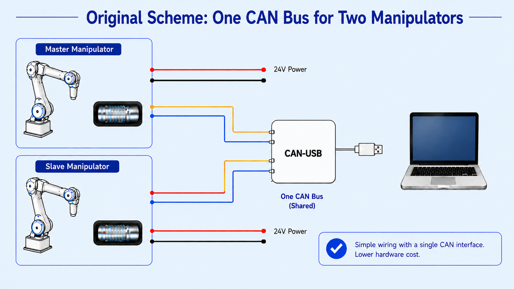
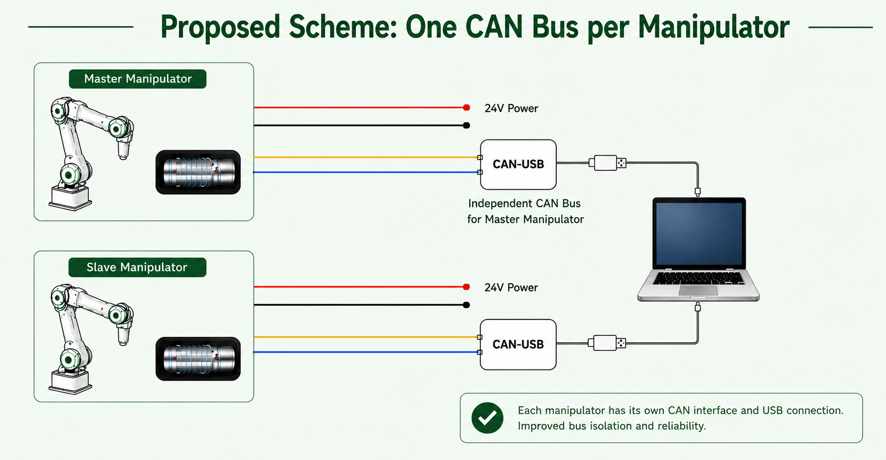

# FluxDAgger：面向双臂机器人操作的模型解耦 DAgger 流水线

<div align="center">
<a href="https://hqr-robotic.github.io/FluxDAgger-project-page/"></a>
</div>

<div align="center">

[English](README.md) | 简体中文

</div>

**FluxDAgger** 是一个面向双臂机器人操作任务的模型解耦 DAgger 流水线。它将策略模型、奖励模型、数据采集控制器和数据处理流程解耦，便于接入不同的 VLA 模型和 reward model。

https://github.com/user-attachments/assets/73ac0c18-d7d8-4326-b260-36df47fe9cee

系统基于模块化 ROS 架构构建，支持多相机同步观测、在线人工接管、DAgger 校正数据采集、reward 可视化，以及数据集处理。

<p align="center">
  
</p>

## 🌟 特性

- **模型解耦设计**：策略推理在外部工程运行，本仓库只消费约定的 ROS topic。
- **人类在环 DAgger**：支持自主 rollout、在线接管和校正数据采集。
- **多相机同步观测**：使用时间戳同步策略对齐多路相机和机器人状态。
- **四臂 Piper 控制**：通过 ROS 节点管理 front/rear、master/slave 四个机械臂。
- **Reward 可视化**：支持在线和离线 Qwen3-VL reward 推理。
- **数据处理流水线**：导出 raw Parquet、分段视频、NumPy 数组和 reward 标注。

## 📢 最新动态

**\[2026/05/29\]** 🔥 FluxDAgger开源了。

## 🛠️ 安装

<details>
<summary><b>1. 克隆仓库</b></summary>

```bash
git clone https://github.com/FluxVLA/FluxDAgger.git
cd FluxDAgger
```

</details>

<details>
<summary><b>2. 配置环境</b></summary>

```bash
bash setup_env.sh
```

`setup_env.sh` 默认使用官方 PyPI。若在中国大陆访问较慢，可通过 `DAGGER_DISABLE_PIP_MIRROR=0` 启用镜像，详见 [技术文档](docs/README_zh-CN.md)。手动装依赖仍见文档「安装」。

</details>

<details>
<summary><b>3. 编译 ROS 工作空间</b></summary>

```bash
source /opt/ros/noetic/setup.bash
catkin_make
source devel/setup.bash
```

</details>

## 使用方式

<details>
<summary><b>启动 FluxDAgger 数据采集</b></summary>

```bash
roslaunch dagger dagger.launch \
  scene_dir:=fold_towels \
  ckpt_dir:=/path/to/checkpoint \
  task_id:=policy_name \
  save_data_base_dir:=/home/agilex/dagger_data/data_buffer
```

</details>

<details>
<summary><b>启动带 Qwen3 reward 的完整采集流程</b></summary>

```bash
roslaunch dagger dagger_with_reward.launch \
  scene_dir:=fold_towels \
  ckpt_dir:=/path/to/checkpoint \
  task_id:=policy_name \
  qwen3_model_path:=/path/to/qwen3_reward/checkpoint \
  save_data_base_dir:=/home/agilex/dagger_data/data_buffer
```

</details>

## 框架

### CAN 总线控制

为了支持四臂遥操作和 DAgger 数据采集，FluxDAgger 对 CAN 线束和接口配置进行了改造。原始的 2 个 USB-CAN 配置被扩展为 4 个独立 USB-CAN 接口，使每个 Piper 机械臂都可以通过独立 CAN 通道访问，而不是共享耦合的控制链路。这样四个 arm_node 可以分别对前/后、主/从机械臂进行使能、模式切换和控制。

| 原始 CAN 总线控制 | 改造后 CAN 总线控制 |
| :---------------: | :-----------------: |
|  |  |

<br>

### 时间戳同步

多路相机流之间的精确时间对齐对于一致的多视角观测非常关键。FluxDAgger 沿用了松灵官方数据采集系统中的时间戳同步实现：每个相机维护自己的帧缓存，并按照统一的同步时间戳对齐图像帧；早于同步时间的帧会被丢弃，从而保证 rollout 和人工接管过程中，各个相机视角对应同一个物理时刻。

<p align="center">
  
</p>

## 仓库结构

```text
FluxDAgger
├── src/
│   ├── dagger/
│   │   ├── config/      # default.yaml — 默认参数单一来源
│   │   ├── dagger/      # Python 包（节点 import dagger.*）
│   │   ├── launch/      # roslaunch
│   │   └── scripts/     # ROS 节点入口
│   └── dagger_msgs/     # 自定义 ROS 消息
├── tools/
│   ├── data_processing/ # Parquet/video/NumPy 数据处理
│   ├── hardware/        # CAN 和 Piper 初始化工具
│   ├── reward_inference/ # 离线 reward 推理脚本
│   └── visualize/       # 实时和离线可视化工具
├── data_example/        # 示例 episode 和工具输出工作区
├── docs/                # 技术文档
├── requirements.txt
└── setup_env.sh
```

## 核心模块

| 模块                        | 说明                                           |
| --------------------------- | ---------------------------------------------- |
| `sync_observation_node.py`  | 发布同步后的多相机和机器人状态观测。           |
| `dagger_controller_node.py` | 管理 episode 状态、键盘命令和机械臂模式切换。  |
| `dagger_collector_node.py`  | 采集同步观测、动作和 episode 元数据。          |
| `qwen3_reward_node.py`      | 异步运行 Qwen3 reward 推理并发布 reward 信号。 |
| `arm_node.py`               | 控制单臂模式、目标订阅和使能状态。             |

## 数据处理

FluxDAgger 将每个采集 episode 保存为包含相机和机器人状态的 Parquet 数据，并进一步处理为多种下游格式：

- human/rollout parquet 子集
- 完整轨迹 MP4 和 NumPy 数组
- 围绕人工接管片段切分的视频
- 离线 reward 标注和可视化结果

## 相关项目

- [FluxVLA](https://github.com/FluxVLA/FluxVLA)：面向 VLA 训练、评测、加速和真机推理的全栈工程平台。
- [ARM](https://arxiv.org/abs/2604.03037)：面向长程机器人操作任务的 Advantage Reward Modeling 方法。

## 支持

如果你在使用本仓库时遇到问题，欢迎联系我们。你可以直接联系 [ryan.hu@limxdynamics.com](mailto:ryan.hu@limxdynamics.com) 和 [wayne@limxdynamics.com](mailto:wayne@limxdynamics.com)，或在 GitHub 提交 issue 获取帮助。

## 🙏 引用与致谢

如果 FluxDAgger 对你的研究或工程有帮助，欢迎引用或链接项目主页。

致谢：FluxDAgger 基于 Piper 机器人生态构建，并使用 [agilexrobotics/piper_sdk](https://github.com/agilexrobotics/piper_sdk) 完成 Piper 机械臂接入。
