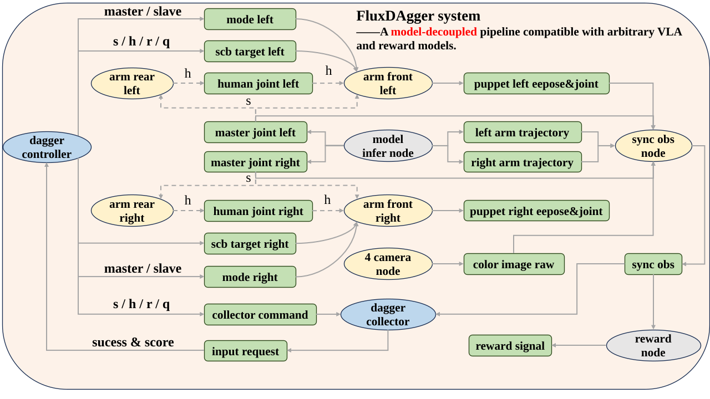
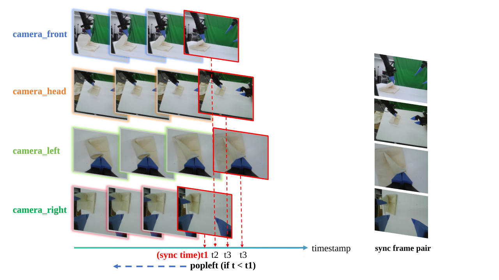

# FluxDAgger：面向双臂机器人操作的模型解耦 DAgger 流水线

<div align="center">
<a href="https://hqr-robotic.github.io/FluxDAgger-project-page/"></a>
</div>

<div align="center">

[English](README.md) | 简体中文

</div>

**FluxDAgger** 是一个面向双臂机器人操作任务的模型解耦 DAgger 流水线。它将策略模型、奖励模型、数据采集控制器和数据处理流程解耦，便于接入不同的 VLA 模型和 reward model。

系统基于模块化 ROS 架构构建，支持多相机同步观测、在线人工接管、DAgger 校正数据采集、Qwen3-VL reward 可视化，以及主机端数据集处理。

<p align="center">
  
</p>

## 目录

- [特性](#特性)
- [仓库结构](#仓库结构)
- [安装](#安装)
- [统一配置（YAML）](#统一配置yaml)
- [真机采集流程](#真机采集流程)
- [使用方式](#使用方式)
- [框架](#框架)
- [数据格式](#数据格式)
- [Reward](#reward)
- [工具脚本](#工具脚本)
- [常见问题](#常见问题)
- [相关项目](#相关项目)
- [支持](#支持)
- [引用与致谢](#引用与致谢)

## <a id="特性"></a>🌟 特性

- **模型解耦设计**：策略推理在外部工程运行，本仓库只消费约定的 ROS topic。
- **人类在环 DAgger**：支持自主 rollout、在线接管和校正数据采集。
- **多相机同步观测**：使用时间戳同步策略对齐多路相机和机器人状态。
- **四臂 Piper 控制**：通过 ROS 节点管理 front/rear、master/slave 四个机械臂。
- **Reward 可视化**：支持在线和离线 Qwen3-VL reward 推理。
- **数据处理流水线**：导出 raw Parquet、分段视频、NumPy 数组和 reward 标注。

## 仓库结构

```text
FluxDAgger
├── src/
│   ├── dagger/
│   │   ├── config/      # default.yaml — 默认参数单一来源
│   │   ├── dagger/      # Python 包（节点 import dagger.*）
│   │   ├── launch/      # roslaunch
│   │   └── scripts/     # ROS 节点入口
│   └── dagger_msgs/     # 自定义 ROS 消息
├── tools/
│   ├── data_processing/ # Parquet/video/NumPy 数据处理
│   ├── hardware/        # CAN 和 Piper 初始化工具
│   ├── reward_inference/ # 离线 reward 推理脚本
│   └── visualize/       # 实时和离线可视化工具
├── data_example/        # 示例 episode 和工具输出工作区
├── requirements.txt
└── setup_env.sh
```

## <a id="安装"></a>🛠️ 安装

系统前提：

- Ubuntu 20.04 + ROS Noetic；
- Python 3.10 conda 环境或兼容环境；
- 真机采集需要已安装 Piper SDK、相机节点和 CAN 设备；
- Qwen3-VL reward 需要可用 GPU 和本地 checkpoint。

<details>
<summary><b>1. 运行一键环境脚本</b></summary>

```bash
export DAGGER_REPO=/path/to/FluxDAgger
cd "$DAGGER_REPO"
bash setup_env.sh
```

</details>

<details>
<summary><b>2. 进入环境</b></summary>

```bash
conda activate fluxdagger
source /opt/ros/noetic/setup.bash
source "$DAGGER_REPO/devel/setup.bash"
```

</details>

<details>
<summary><b>中国大陆或访问 PyPI 较慢</b></summary>

`setup_env.sh` 默认使用官方 PyPI。需要镜像时设置 `DAGGER_DISABLE_PIP_MIRROR=0`；`DAGGER_PIP_INDEX_URL` 默认使用清华镜像。`requirements.txt` 里的 `--extra-index-url` 仍保留，CUDA 版 PyTorch 仍从 PyTorch 官方索引解析。

```bash
# 启用清华镜像
DAGGER_DISABLE_PIP_MIRROR=0 bash setup_env.sh

# 改用其他镜像
DAGGER_DISABLE_PIP_MIRROR=0 \
  DAGGER_PIP_INDEX_URL=https://mirrors.aliyun.com/pypi/simple/ \
  bash setup_env.sh
```

使用 PyPI 镜像手动安装：

```bash
pip install -U pip setuptools wheel -i https://pypi.tuna.tsinghua.edu.cn/simple
pip install -r "$DAGGER_REPO/requirements.txt" -i https://pypi.tuna.tsinghua.edu.cn/simple
```

也可在 `~/.pip/pip.conf` 或通过 `pip config set` 配置全局 `index-url`。

</details>

<details>
<summary><b>3. 编译 ROS 工作空间</b></summary>

```bash
cd "$DAGGER_REPO"
catkin_make
source devel/setup.bash
```

</details>

## 统一配置（YAML）

默认参数集中在 `src/dagger/config/default.yaml`，由 `dagger.runtime_config` 加载。各节点通过 ROS 私有参数 `config_file` 指定文件（launch 默认：`$(find dagger)/config/default.yaml`）。 Launch 里多数 `<arg>` 会传给对应节点的 `<param>`；占位值 `__config__` 表示「该键使用 YAML 中的值」。在命令行显式传入的 launch 实参只覆盖当次运行。

YAML 中的 `{home_dir}`、`{repo_dir}` 在加载时展开（`repo_dir` 由配置文件路径推断）。

## 真机采集流程

相机节点和 Piper SDK 均来自官方工程，本仓库只依赖它们发布的 ROS topic 和 CAN 接口。相机、Piper SDK 和外部策略推理代码不放入本仓库。

外部依赖来源：

- 相机节点：官方 `astra_camera` ROS 节点，启动命令为 `roslaunch astra_camera nmulti_camera.launch`。
- Piper SDK：AgileX 官方 SDK，来源为 <https://github.com/agilexrobotics/piper_sdk>。
- 策略推理：外部 VLA/policy 工程，当前接口与 FluxVLA 对应，需要持续发布 FluxDAgger 消费的 command 和 raw-action topic。

如果插拔过 USB-CAN 设备，先重新配置 CAN 口：

```bash
cd "$DAGGER_REPO"
sudo ./tools/hardware/can_config_modified.sh
```

`tools/hardware/can_config_modified.sh`参考脚本为 Piper ROS 工程中的 `can_config.sh`。

关键 CAN 修改：

| 项目         | 修改前 `can_config.sh` | 修改后 `can_config_modified.sh` |
| ------------ | ---------------------- | ------------------------------- |
| CAN 模块数量 | `EXPECTED_CAN_COUNT=3` | `EXPECTED_CAN_COUNT=4`          |
| `1-13:1.0`   | `can_left:1000000`     | `c_left_slave:1000000`          |
| `1-12:1.0`   | `can_right:1000000`    | `c_left_master:1000000`         |
| `1-5:1.0`    | 未配置                 | `c_right_master:1000000`        |
| `1-2:1.0`    | `can0:500000`          | `c_right_slave:1000000`         |

这些接口名需要和 `src/dagger/launch/dagger.launch` 中四个 `arm_node` 的 `can_port` 保持一致：

| DAgger arm node   | CAN 口           |
| ----------------- | ---------------- |
| `arm_front_left`  | `c_left_slave`   |
| `arm_front_right` | `c_right_slave`  |
| `arm_rear_left`   | `c_left_master`  |
| `arm_rear_right`  | `c_right_master` |

推荐启动顺序：

1. 启动相机节点。

```bash
roslaunch astra_camera nmulti_camera.launch
```

2. 将四臂设置为主从关系并移动到平行初始姿态。`piper_initial_pose.py` 可以反复运行，直到四臂均平行呈水平状态。

```bash
cd "$DAGGER_REPO"
python tools/hardware/piper_set_slave.py
python tools/hardware/piper_initial_pose.py
```

3. 启动外部模型推理。实际使用时按自己的推理工程、配置文件和 checkpoint 替换。

```bash
conda activate <policy_inference_env>
cd <policy_inference_project>

python <inference_entrypoint>.py \
  --config <policy_config> \
  --ckpt-path <policy_checkpoint>
```

<details>
<summary><b>4. 编译并启动 DAgger 采集</b></summary>

```bash
cd "$DAGGER_REPO"
catkin_make
source ./devel/setup.bash
roslaunch dagger dagger.launch
```

</details>

采集按键：

| 按键 | 行为                              |
| ---- | --------------------------------- |
| `s`  | 开始 episode，进入 inference 模式 |
| `h`  | 切到 human 模式，后臂作为 master  |
| `i`  | 切回 inference 模式               |
| `r`  | 停止并保存，输入 success 和 score |
| `d`  | 丢弃当前 episode                  |
| `q`  | 退出并广播 shutdown               |

## 使用方式

<details>
<summary><b>启动前检查</b></summary>

```bash
source /opt/ros/noetic/setup.bash
source "$DAGGER_REPO/devel/setup.bash"
roscore
```

</details>

<details>
<summary><b>确认传感器 topic 正常</b></summary>

```bash
rostopic hz /camera_h/color/image_raw
rostopic hz /camera_l/color/image_raw
rostopic hz /camera_r/color/image_raw
rostopic hz /puppet/joint_left
rostopic hz /puppet/joint_right
```

</details>

<details>
<summary><b>纯 DAgger 数据采集</b></summary>

```bash
roslaunch dagger dagger.launch \
  scene_dir:=fold_towels \
  ckpt_dir:=/path/to/checkpoint \
  task_id:=policy_name \
  save_data_base_dir:=/path/to/dagger_data/data_buffer
```

</details>

<details>
<summary><b>可选：让所有节点使用自定义配置文件</b></summary>

```bash
roslaunch dagger dagger.launch \
  config_file:=/path/to/my_dagger.yaml \
  scene_dir:=fold_towels \
  ckpt_dir:=/path/to/checkpoint \
  task_id:=policy_name \
  save_data_base_dir:=/path/to/dagger_data/data_buffer
```

</details>

<details>
<summary><b>完整采集系统 + Qwen3-VL reward</b></summary>

```bash
roslaunch dagger dagger_with_reward.launch \
  scene_dir:=fold_towels \
  ckpt_dir:=/path/to/checkpoint \
  task_id:=policy_name \
  qwen3_model_path:=$DAGGER_REPO/ckpt/reward_model/qwen3_reward/step35000 \
  save_data_base_dir:=/path/to/dagger_data/data_buffer
```

</details>

`dagger.launch` 常用参数（未覆盖时与 `default.yaml` 一致）：

| 参数                    | 默认值                               | 说明                                                     |
| ----------------------- | ------------------------------------ | -------------------------------------------------------- |
| `config_file`           | `$(find dagger)/config/default.yaml` | 本 launch 内各节点的统一 YAML                            |
| `scene_dir`             | `fold_towels`                        | 任务/场景目录名                                          |
| `ckpt_dir`              | `/tmp/test_sync`                     | 策略 checkpoint 路径，用于生成保存目录                   |
| `task_id`               | `test_policy`                        | 策略或实验名                                             |
| `save_data_base_dir`    | `~/dagger_data/data_buffer`          | 数据根目录（对应 YAML `paths.data_buffer_dir`）          |
| `collect_frame_data`    | `true`                               | 是否启动采集保存                                         |
| `sync_observation_rate` | `90.0`                               | 同步节点循环频率（Hz）                                   |
| `data_collection_rate`  | `30.0`                               | 采集线程节拍；每次最多保存当前最新的 `SyncedObservation` |
| `sync_slop`             | `0.03`                               | 多路流时间对齐允许的最大时间跨度（秒）                   |
| `img_front_topic`       | 空                                   | 可选前视相机                                             |
| `img_head_topic`        | `/camera_h/color/image_raw`          | 头顶相机                                                 |
| `img_left_topic`        | `/camera_l/color/image_raw`          | 左腕相机                                                 |
| `img_right_topic`       | `/camera_r/color/image_raw`          | 右腕相机                                                 |

## 框架

多路相机流之间的精确时间对齐对于一致的多视角观测非常关键。FluxDAgger 沿用了松灵官方数据采集系统中的时间戳同步实现：每个相机维护自己的帧缓存，并按照统一的同步时间戳对齐图像帧；早于同步时间的帧会被丢弃，从而保证 rollout 和人工接管过程中，各个相机视角对应同一个物理时刻。

<p align="center">
  
</p>

节点拓扑：

```text
raw sensors
  /camera_h/color/image_raw
  /camera_l/color/image_raw
  /camera_r/color/image_raw
  /camera_f/color/image_raw (optional)
  /puppet/joint_left
  /puppet/joint_right
  /puppet/end_pose_left
  /puppet/end_pose_right
       |
       v
sync_observation_node
       |
       +--> /robot/observation_sync
                |
                +--> dagger_collector_node -> episode parquet + sensor_index.json
                |
                +--> qwen3_reward_node -> /robot/reward_signal

dagger_controller_node
       |
       +--> /dagger/global_state
       +--> /dagger/control/command
       +--> /dagger/collector/command
       +--> /dagger/arm/<name>/mode
       +--> /dagger/arm/<name>/subscribe_target
       +--> /dagger/arm/<name>/enable
                |
                +--> arm_node x 4
```

核心模块：

| 模块                                  | 说明                                                                                                                                               |
| ------------------------------------- | -------------------------------------------------------------------------------------------------------------------------------------------------- |
| `dagger.runtime_config`               | 从 `src/dagger/config/default.yaml` 加载 ROS topic、相机名、路径、四臂 profile 和归位姿态。                                                        |
| `dagger.infra.ros_observation_buffer` | 订阅相机、机械臂、command 和 raw-action topic，并维护消息队列。                                                                                    |
| `dagger.infra.frame_sync`             | 根据同步窗口选择对齐帧，返回 `FrameData`。                                                                                                         |
| `sync_observation_node.py`            | 发布 `SyncedObservation`，维护 `episode_id` 和 `step_id`。                                                                                         |
| `dagger_collector_node.py`            | 接收 `SyncedObservation`，对齐 command/raw-action 队列并写 parquet；工作线程按 `data_collection_rate` 抽样（每拍取当前最新一条，非队列全量消费）。 |
| `dagger_controller_node.py`           | 管理键盘输入、全局状态、episode 生命周期和四臂模式切换。                                                                                           |
| `qwen3_reward_node.py`                | 异步运行 Qwen3 reward 推理并发布 reward 信号。                                                                                                     |
| `arm_node.py`                         | 控制单臂模式、目标订阅和使能状态。                                                                                                                 |

Episode 生命周期：

1. 用户按 `s`。
2. Controller 发布 `start_collect`、`start_episode` 和全局状态。
3. Collector 创建新 episode 目录，并发布 `EpisodeInfo(is_active=True)`。
4. SyncNode 收到 `EpisodeInfo` 后重置 `step_id`。
5. 每帧 `SyncedObservation` 携带当前 `episode_id` 和 `step_id`。
6. 用户按 `h` / `i` 在 human 和 inference 之间切换。
7. 用户按 `r` 结束，Collector 请求 success 和 score 后写盘。
8. 用户按 `d` 丢弃当前 episode，Collector 删除当前 episode 目录。
9. 用户按 `q`，Controller 发布退出命令，各节点 shutdown。

主要 topic：

| Topic                              | 类型                | 发布者     | 订阅者                      |
| ---------------------------------- | ------------------- | ---------- | --------------------------- |
| `/robot/observation_sync`          | `SyncedObservation` | SyncNode   | Collector, Reward           |
| `/robot/reward_signal`             | `RewardSignal`      | Reward     | Visualization               |
| `/dagger/global_state`             | `GlobalState`       | Controller | Collector, ArmNode          |
| `/dagger/control/command`          | `String`            | Controller | ArmNode, SyncNode, Reward   |
| `/dagger/collector/command`        | `String`            | Controller | Collector, SyncNode, Reward |
| `/dagger/episode_info`             | `EpisodeInfo`       | Collector  | SyncNode                    |
| `/dagger/controller/input_request` | `InputRequest`      | Collector  | Controller                  |
| `/dagger/controller/input_result`  | `InputResult`       | Controller | Collector                   |
| `/dagger/arm/<name>/status`        | `ArmStatus`         | ArmNode    | Controller                  |

硬件和策略相关 topic：

| Topic                                              | 说明                         |
| -------------------------------------------------- | ---------------------------- |
| `/camera_h/color/image_raw`                        | 头顶相机                     |
| `/camera_l/color/image_raw`                        | 左腕相机                     |
| `/camera_r/color/image_raw`                        | 右腕相机                     |
| `/camera_f/color/image_raw`                        | 可选前视相机                 |
| `/puppet/joint_left` / `/puppet/joint_right`       | 前臂关节状态                 |
| `/puppet/end_pose_left` / `/puppet/end_pose_right` | 前臂末端位姿                 |
| `/master/joint_left` / `/master/joint_right`       | 策略或人工操作给出的关节命令 |
| `/left_arm/trajectory` / `/right_arm/trajectory`   | 策略 raw action chunks       |

## 数据格式

Collector 将数据写入：

```text
<save_data_base_dir>/<scene_dir>/<YYYYMMDD>/<checkpoint_folder>/<task_id>/episode_XXX/
```

示例：

```text
<save_data_base_dir>/
  fold_towels/
    20260511/
      policy_ckpt_folder/
        policy_name/
          episode_000/
            episode_000.parquet
            sensor_index.json
            actions/
```

Parquet 字段：

| 列名                                   | 类型          | 说明                            |
| -------------------------------------- | ------------- | ------------------------------- |
| `/observations/qpos`                   | `float32[14]` | 左右前臂关节位置                |
| `/observations/qvel`                   | `float32[14]` | 左右前臂关节速度                |
| `/observations/effort`                 | `float32[14]` | 左右前臂关节力矩                |
| `/observations/eepose`                 | `float32[14]` | 左右前臂末端位姿，左右各 7 维   |
| `/observations/images/cam_high`        | PNG bytes     | 头顶相机                        |
| `/observations/images/cam_left_wrist`  | PNG bytes     | 左腕相机                        |
| `/observations/images/cam_right_wrist` | PNG bytes     | 右腕相机                        |
| `/observations/images/cam_front`       | PNG bytes     | 可选前视相机                    |
| `/action`                              | `float32[]`   | 同步到当前帧的关节命令          |
| `/data_flag`                           | semantic flag | rollout 或 human 数据标记       |
| `/success`                             | `int`         | episode 级 success 标签         |
| `/score`                               | `int`         | episode 评分，失败时通常为 `-1` |

若双臂关节状态、速度、力矩或末端位姿不完整，该帧会被 **跳过**（不会用零向量补齐）。当前流水线 **不** 写入 `base_action` / 底盘速度类列。

`sensor_index.json` 记录 success/score、frame mode、同步源时间戳和 raw action chunk 文件引用。`actions/` 下保存 raw action chunks，便于分析策略输出和实际执行动作的关系。

数据流水线输出：

- human/rollout parquet 子集；
- 完整轨迹 MP4 和 NumPy 数组；
- 围绕人工接管片段切分的视频；
- 离线 reward 标注和可视化结果。

## Reward

当前主线包含 Qwen3-VL reward。Reward 节点读取 `/robot/observation_sync`，输出统一的 `/robot/reward_signal`，用于可视化、记录和上层策略模块。

启动带在线 reward 的完整采集栈：

```bash
roslaunch dagger dagger_with_reward.launch \
  scene_dir:=fold_towels \
  ckpt_dir:=/path/to/checkpoint \
  task_id:=policy_name \
  qwen3_model_path:=$DAGGER_REPO/ckpt/reward_model/qwen3_reward/step35000 \
  save_data_base_dir:=/path/to/dagger_data/data_buffer
```

`Qwen3RewardModel` 使用 `cam_high`、`cam_left_wrist`、`cam_right_wrist` 三路图像缓存。常用参数包括：

| 参数             | 说明                             |
| ---------------- | -------------------------------- |
| `f_interval`     | 一个推理窗口中相邻帧的 step 间隔 |
| `t_interval`     | 两次推理调用之间的最小 step 间隔 |
| `prompt`         | 传给 Qwen3-VL 的任务描述         |
| `max_new_tokens` | 最大生成 token 数                |

模型输出文本会解析为状态标签：

| 状态         | Reward |
| ------------ | ------ |
| `Normal`     | `1.0`  |
| `Static`     | `0.3`  |
| `Grasp fail` | `0.0`  |
| `Shaking`    | `0.1`  |
| `Drop`       | `0.0`  |

离线 reward：

```bash
python tools/reward_inference/qwen3_reward_inference.py \
  --src_dir /path/to/mp4_npy_data \
  --save_mp4 /path/to/save_dir \
  --start 0 \
  --end 100 \
  --model_path "$DAGGER_REPO/ckpt/reward_model/qwen3_reward/step35000"
```

## 工具脚本

`tools/` 包含离线数据处理、可视化、回放、reward 推理和真机硬件准备脚本。以下命令默认从仓库根目录运行：

```bash
cd "$DAGGER_REPO"
```

工具概览：

| 工具                                               | 用途                                               |
| -------------------------------------------------- | -------------------------------------------------- |
| `tools/hardware/can_config_modified.sh`            | 配置四臂采集使用的 CAN 接口。                      |
| `tools/hardware/piper_set_slave.py`                | 设置 Piper 主从关系。                              |
| `tools/hardware/piper_initial_pose.py`             | 将四臂移动到平行初始姿态。                         |
| `tools/data_processing/split_parquet_by_mode.py`   | 将 raw parquet episode 切分为 human/rollout 子集。 |
| `tools/data_processing/parquet_to_mp4_npy.py`      | 将 parquet 子集转为 MP4 和 NumPy 数组。            |
| `tools/visualize/visualize_parquet.py`             | 查看单个 parquet episode 并保存图像/曲线。         |
| `tools/visualize/visualize_ros_reward.py`          | 实时查看 ROS 相机流和 reward 信号。                |
| `tools/replay_qpos_npy.py`                         | 将保存的 qpos 数组回放到 ROS 关节命令 topic。      |
| `tools/reward_inference/qwen3_reward_inference.py` | 对 MP4/NPY 数据运行离线 Qwen3 reward。             |

常用命令：

```bash
python tools/data_processing/split_parquet_by_mode.py \
  --input_base /path/to/raw_dataset \
  --output_base /path/to/sub_parquet_dataset

python tools/data_processing/parquet_to_mp4_npy.py \
  --input_base /path/to/sub_parquet_dataset \
  --output_base /path/to/mp4_npy_dataset \
  --fps 30

python tools/visualize/visualize_parquet.py \
  /path/to/episode_000.parquet \
  --save-plots \
  --save-qpos \
  --save-action \
  --output-dir /tmp/episode_000_vis

python tools/visualize/visualize_ros_reward.py \
  --cameras h,l,r \
  --reward_topic /robot/reward_signal

python tools/reward_inference/qwen3_reward_inference.py \
  --src_dir /path/to/mp4_npy_dataset \
  --save_mp4 /path/to/reward_output \
  --start 0 \
  --end 100 \
  --model_path /path/to/qwen3_reward/checkpoint
```

查看单个脚本的完整参数：

```bash
python <script> --help
```

## 常见问题

`dagger_msgs` 无法导入：

<details>
<summary><b>重新编译并 source 工作空间</b></summary>

```bash
cd "$DAGGER_REPO"
catkin_make
source devel/setup.bash
```

</details>

传感器 topic 为空：

```bash
rostopic hz /camera_h/color/image_raw
rostopic hz /camera_l/color/image_raw
rostopic hz /camera_r/color/image_raw
rostopic hz /puppet/joint_left
rostopic hz /puppet/joint_right
```

Qwen3 reward 不发布：

- 确认 `qwen3_reward_node.py` 正在运行；
- 确认 `/robot/observation_sync` 正在发布；
- 确认 model path 指向本地 Qwen3 reward checkpoint；
- 确认 GPU 显存足够。

## 相关项目

- [FluxVLA](https://github.com/FluxVLA/FluxVLA)：面向 VLA 训练、评测、加速和真机推理的全栈工程平台。
- [ARM](https://arxiv.org/abs/2604.03037)：面向长程机器人操作任务的 Advantage Reward Modeling 方法。

## 支持

如果你在使用本仓库时遇到问题，欢迎联系我们。你可以直接联系 [ryan.hu@limxdynamics.com](mailto:ryan.hu@limxdynamics.com) 和 [wayne@limxdynamics.com](mailto:wayne@limxdynamics.com)，或在 GitHub 提交 issue 获取帮助。

## <a id="引用与致谢"></a>🙏 引用与致谢

如果 FluxDAgger 对你的研究或工程有帮助，欢迎引用或链接项目主页。

致谢：FluxDAgger 基于 Piper 机器人生态构建，并使用 [agilexrobotics/piper_sdk](https://github.com/agilexrobotics/piper_sdk) 完成 Piper 机械臂接入。
